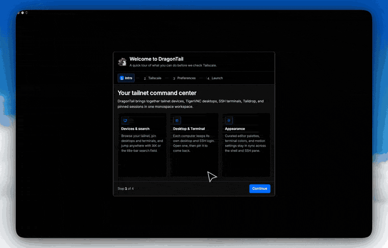

<p align="center">
  <picture>
    <source media="(prefers-color-scheme: dark)" srcset="ui/public/dragontail-logo-dark.svg">
    
  </picture>
</p>

<h1 align="center">DragonTail</h1>

<p align="center">See and control every machine on your tailnet from one Mac app.</p>

<p align="center">DragonTail is not made by Tailscale.</p>

<p align="center">
  <a href="https://github.com/adityachauhan0/DragonTail/releases/latest"></a>
  <a href="LICENSE"></a>
  <a href="https://github.com/adityachauhan0/DragonTail/stargazers"></a>
</p>

<p align="center">
  
</p>

<p align="center">The tailnet, a live desktop, and the terminal. <a href="docs/demo.mp4">MP4</a> · <a href="docs/demo.webm">WebM</a></p>

## Download

[DragonTail_0.1.0_aarch64.dmg](https://github.com/adityachauhan0/DragonTail/releases/download/v0.1.0/DragonTail_0.1.0_aarch64.dmg)

Open the disk image and move DragonTail to Applications. The build is ad-hoc signed. If macOS blocks it, right-click the app and choose Open.

## Prerequisites

- Tailscale is installed on this Mac, and you are logged in.
- The computer you want to view is on that tailnet, with a VNC server listening on a port.
- DragonTail includes the viewer, and draws the desktop in the app.

## Privacy

**Private by design.** DragonTail runs entirely on your Mac and talks to your tailnet through the local Tailscale daemon. No DragonTail account, no telemetry, and no relay of its own: it reads your tailnet locally and connects to your machines over that tailnet. Tailscale may still use its coordination servers and relays. The network check runs `tailscale netcheck`, which contacts Tailscale.

Keep VNC reachable only on your tailnet; never expose it to the public internet.

## Enable VNC on the target

DragonTail does not set up the VNC server. Turn a server on for the computer you want to view.

### macOS

System Settings > General > Sharing > Screen Sharing.

### Linux

- **wayvnc** serves a Wayland session on wlroots compositors such as sway.
- **x11vnc** attaches to a running X11 display.
- **TigerVNC** shares the current X session with `x0vncserver`, or starts a virtual desktop with `vncserver`.

## Why not just Screen Sharing?

macOS Screen Sharing reaches other Macs. DragonTail keeps a tailnet-aware device list, opens Linux targets, and puts SSH, Taildrop, and ping in the same window.

## What you can do

- See the computers on your tailnet
- Ping a computer and send it a file with Taildrop
- Open an SSH session with the `ssh` already on this Mac
- Open that computer's desktop in DragonTail

## Limitations

Apple silicon only, not notarized yet (right-click > Open on first launch), and the target needs a VNC server.

## Build

Node.js, npm, and Rust are required.

```bash
npm install
npm run tauri dev
```

```bash
npm run tauri build
```

The app and the disk image are written under `target/release/bundle/`.

## License

[MIT](LICENSE). Commit Mono, the terminal face, is under the SIL Open Font License in [`ui/public/fonts/OFL.txt`](ui/public/fonts/OFL.txt).
